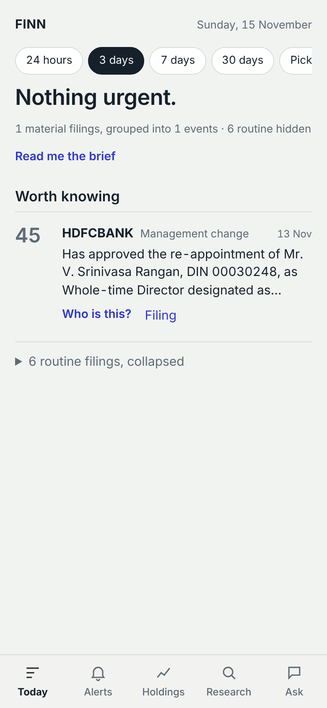
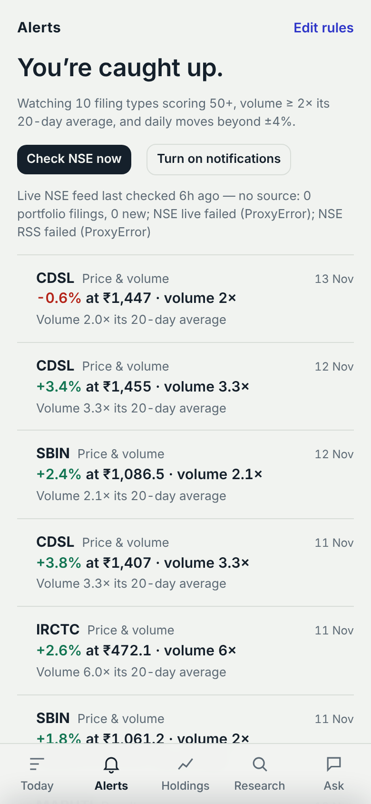
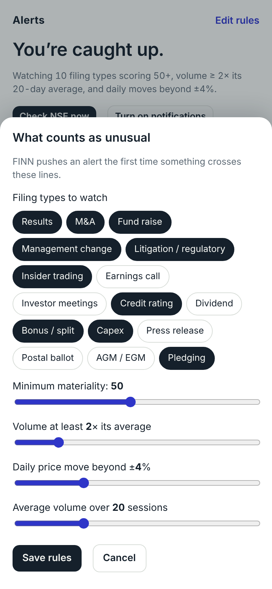
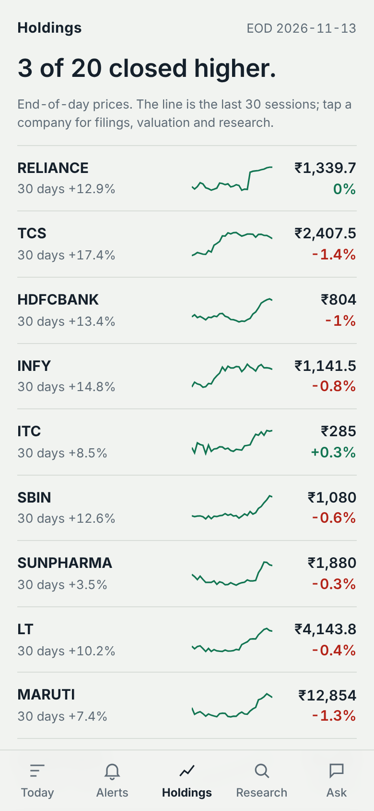
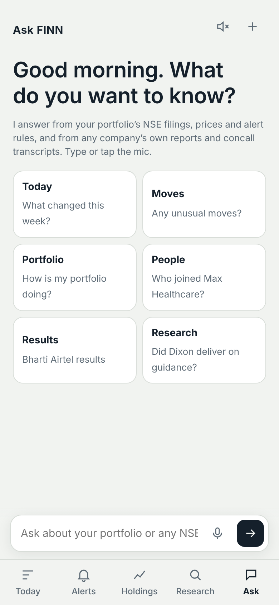
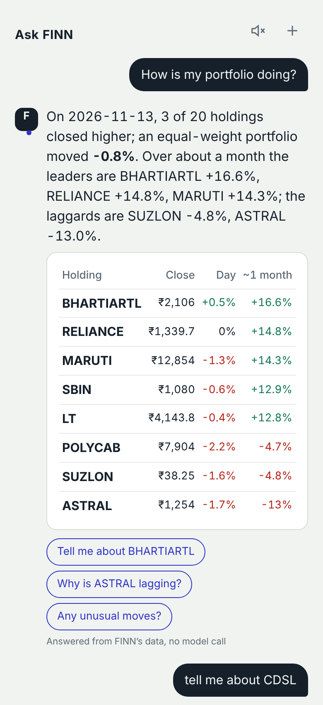
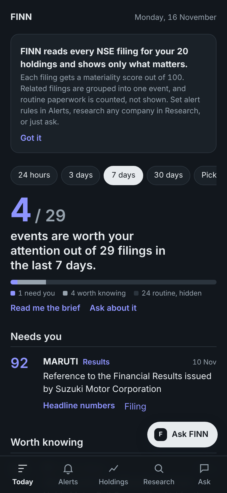
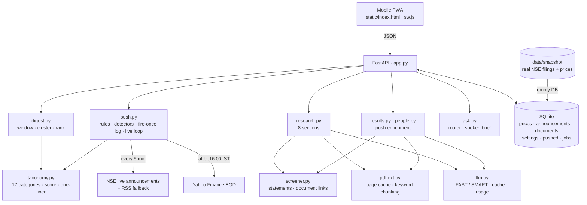

# FINN — financial investment agent

FINN is a mobile-first triage tool for an Indian equity investor. Its point of view: **an investor needs an inbox,
not a dashboard.** Everything that reaches the screen has been scored for materiality, related filings are folded
into one event, routine paperwork is counted rather than shown, and every number links back to the primary source.

**Live app:** [finnportfoliobyiom.vercel.app](https://finnportfoliobyiom.vercel.app/)

**Project docs:** [Feature design](FEATURE_DESIGN.md) · [AI build history](aihistory.md) · [Submission note](SUBMISSION.md)

It works in the two modes the brief asks for:

| | What it does | Where |
|---|---|---|
| **Push · digest** | Every NSE filing across the 20-stock portfolio for a window you pick (24h / 3d / 7d / 30d / custom dates), mapped to the 17 reference categories, scored 0–100, clustered per event, routine collapsed. A one-paragraph brief can be read aloud. | Today |
| **Push · triggered alerts** | You set the rules: which filing types, minimum materiality, volume ≥ N× its average, daily move beyond ±X %, lookback. FINN polls the **live NSE announcements feed** (one request for the whole portfolio, RSS fallback), pulls EOD prices after the close, and fires each alert once — as an in-app inbox item and a system notification. Price spikes on a filing day are linked to that filing. | Alerts |
| **Push · results** | Revenue, EBITDA, PBT, PAT from the actual results filing (cheap model), QoQ/YoY computed in code, cross-checked against Screener's quarterly table. No key → Screener numbers, labelled. | "Headline numbers" on any results item |
| **Push · management change** | Who is coming in and where from: name/role from the filing headline (regex, free) → the filing's own SEBI profile annexure (cheap model) → web-grounded background with sources (Gemini + Google Search) → LinkedIn search link. | "Who is this?" |
| **Pull · research** | All eight menu items for **any NSE ticker** on Screener: business snapshot, financial snapshot, trajectory, balance sheet, cash quality, guidance, promised-vs-delivered, bull vs bear. | Research |
| **Ask FINN (chat)** | A conversational copilot, typed or spoken (en-IN voice in, optional read-aloud). It remembers the company you're discussing ("what about their debt?"), answers with the same cards used across the app, and suggests follow-ups. Every reply is grounded: FINN's tools gather the facts, a factual answer is composed from them, and with a key the model rewrites it conversationally from only those facts plus the chat history (`chat.py`). Without a key, or if the model fails, it still answers. A floating Ask button on every screen opens it in context. | Ask, or the Ask button |

<p>







</p>

**Design notes.** One family (Instrument Sans) with tabular figures. The materiality score is the visual anchor of
every row, and the Today hero states how much was filtered ("4 / 29 filings"). Hairline rows instead of a stack of cards. Light and dark themes follow the phone. On a quiet day the default view widens itself and says so,
instead of opening on an empty screen. On desktop the app is shown framed at phone width with a short explainer.

## Primary sources only on the pull side

| Section | Source | Model cost |
|---|---|---|
| Financial snapshot, trajectory, balance sheet, cash quality | Screener's standardised statements (from filings), parsed and computed in Python | **none** |
| Business snapshot | Latest annual report, keyword-chunked to the ~15 most relevant pages | 1 fast call |
| Guidance | Latest two concall transcripts; flags guidance that is new or dropped | 2 fast calls (shared cache) |
| Promised vs delivered | Last four transcripts **plus the actual reported quarterly numbers** | 4 fast + 1 reasoning |
| Bull vs bear | Only the computed facts and the company's own guidance | 1 reasoning call |

Prompts forbid outside knowledge; no news or broker notes are used in research. Web enrichment is used only on
the push side for a person's background, which the brief allows.

## Cost discipline

- Rules, not a model, for classification, scoring, clustering, routing, alerts and the spoken brief.
- Model routing: `FINN_FAST_MODEL` for extraction, `FINN_SMART_MODEL` only for judgement (promised vs delivered, bull/bear).
- Every model call is cached by (model, prompt); PDFs are cached per page; Screener pages for 24 h.
- Research sections run only when opened. Four of eight cost nothing.
- NSE's own announcement summaries are used when present instead of generating one.
- `/api/usage` reports calls, cache hits and tokens per model.

## Architecture



**How push runs.** On a long-lived server (local or Render) a daemon thread calls `push.tick()` every
`FINN_LIVE_INTERVAL` seconds (default 300). On serverless hosts with no scheduler, the open app calls
`/api/push/poll` every minute, which runs the same throttled tick. Either way, an alert is written to the `pushed`
table once and never re-sent. When rules change, matching events older than 48 hours are filed as already read,
so you aren't flooded. The service worker shows notifications and already handles `push` events, ready for VAPID
Web Push when the app is closed.

**Data on a fresh deploy.** `data/snapshot/` holds the real NSE filings (16 Oct – 14 Nov 2026), Yahoo EOD prices and
Screener document links. An empty database loads it automatically, so the hosted demo shows real announcements,
not simulated ones. `python run_day1.py` refreshes data and the snapshot. `seed_demo.py` remains only as a last resort.

## API

| Route | Purpose |
|---|---|
| `GET /api/feed?hours=24` · `?start=YYYY-MM-DD&end=YYYY-MM-DD` | Windowed digest (clustered, tiered) |
| `GET /api/brief?hours=24` | Spoken-length summary |
| `GET/PUT /api/rules` · `GET /api/categories` | Alert rules |
| `GET /api/inbox` · `POST /api/inbox/seen` | Triggered alerts + read state |
| `GET /api/push/poll?since=` · `POST /api/live/refresh` | Throttled live tick / forced NSE check |
| `GET /api/results/{id}` · `GET /api/people/{id}` | Push enrichment |
| `GET /api/research/{symbol}` · `GET /api/research/{symbol}/{section}` | Pull research (overview + lazy sections) |
| `POST /api/chat` `{message, history, symbol}` | Conversational reply + cards + follow-ups |
| `GET /api/ask?q=` | Lightweight intent router |
| `GET /api/portfolio` · `GET /api/stocks/{symbol}` · `POST /api/stocks/{symbol}/refresh` | Holdings and stock detail |
| `GET /api/status` · `GET /api/usage` · `GET /healthz` | Freshness, watcher state, model spend |

## Run locally

Requires Python 3.10+.

```powershell
py -m venv .venv
.\.venv\Scripts\Activate.ps1
python -m pip install -r requirements.txt
uvicorn app:app --reload --port 8000
```

Open http://localhost:8000. On a phone on the same Wi-Fi, start with `--host 0.0.0.0` and open the laptop's LAN IP;
"Add to Home Screen" installs it as an app. Put `GEMINI_API_KEY=...` in `.env` to enable filing/transcript reading.
Without it, the digest, alerts, live feed, the four computed research sections, and results via Screener all still work.

| Env var | Default | |
|---|---|---|
| `GEMINI_API_KEY` | — | Enables reading PDFs and web background |
| `FINN_FAST_MODEL` / `FINN_SMART_MODEL` | `gemini-3.5-flash-lite` / `gemini-3.8-flash` | Model routing |
| `FINN_LIVE` | `1` | `0` disables the background NSE watcher |
| `FINN_LIVE_INTERVAL` | `300` | Seconds between live NSE polls |
| `FINN_DB_PATH` / `FINN_CACHE_DIR` | `data/finn.db` / `data/cache` | Storage |

Tests: `python -m unittest -v test_sources test_features` (32 tests; CI runs them on every push).

## Deploy

**Render (recommended — keeps the watcher thread alive):** New → Blueprint → this repo, then set `GEMINI_API_KEY`.
**Vercel:** import the repo with the FastAPI preset. There's no background thread there; the app's own polling drives
the live checks. Both use temporary storage, so the database reloads from `data/snapshot/` on a cold start.

## Limits, honestly

- NSE blocks some cloud IP ranges. When both the live API and RSS fail, the Alerts screen says so, and the
  stored data still drives the app.
- Notifications fire while the app is open or installed. True closed-app push needs a VAPID push service (the service worker is ready for it).
- Single user, no accounts. Rules live in the server's SQLite.
- Screener's consolidated vs standalone basis can differ from a filing; the results card shows the disagreement rather than hiding it.
- A research aid, not investment advice.

See [SUBMISSION.md](SUBMISSION.md) for the covering note.
