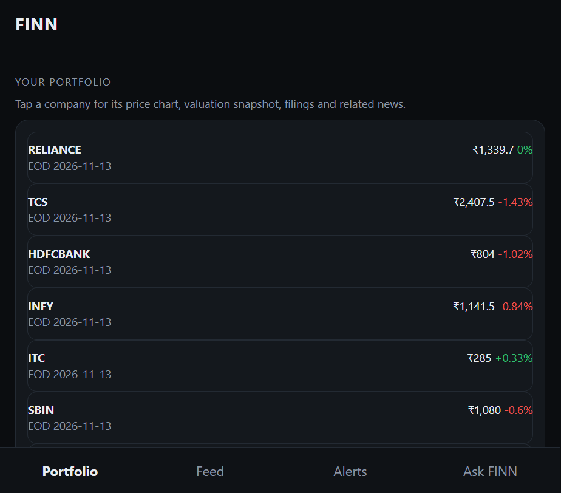
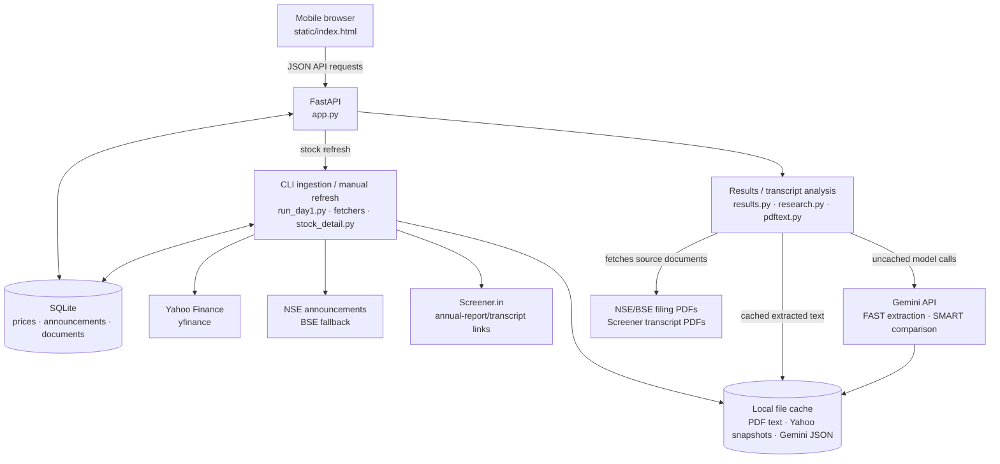

# FINN — financial investment agent

FINN is a mobile-first prototype for an investor's daily workflow:

- **Feed:** prioritised company announcements for a configurable time window; routine items are collapsed.
- **Portfolio / stock detail:** tap a holding or feed symbol to see its stored EOD price chart, Yahoo Finance valuation/fundamental snapshot and related news links, plus NSE/BSE filings. Refresh checks public sources on demand with a 15-minute cooldown.
- **Alerts:** configurable end-of-day volume and price-move thresholds.
- **Results:** extracts Revenue, EBITDA, PBT and PAT from a results filing; calculates QoQ/YoY in Python and links back to the filing.
- **Research:** compares management guidance with later concall reporting and links to the source transcripts.

## Website snapshot



This is a UI snapshot; prices shown are stored end-of-day values, not live quotes.

## Architecture

FINN is a small, single-service prototype: a responsive browser UI talks to a FastAPI application, which reads/writes a local SQLite database and calls public data providers or Gemini only for specific workflows.



### Runtime components

| Component | Responsibility |
| --- | --- |
| `static/index.html` | Mobile-first Feed, Portfolio, Alerts, Ask FINN and stock-detail screens. Calls the JSON API and renders the price chart, metrics, filing/news links and source/error states. |
| `app.py` | FastAPI entry point; serves the UI and exposes health, feed, alert, status, portfolio, stock detail, refresh, result and research routes. |
| `config.py` | Mock portfolio, optional BSE scrip codes, ad-hoc research tickers, request headers and configurable data/cache paths. |
| `db.py` | Creates the SQLite schema and connection: `prices` (daily OHLCV), `announcements` (filing metadata/source/raw payload) and `documents` (annual-report/transcript links). |
| `fetch_prices.py` | Retrieves end-of-day NSE history through Yahoo Finance (`.NS`) and upserts it into `prices`. |
| `fetch_announcements.py` | Retrieves NSE corporate announcements, falls back to BSE where a scrip code is configured, stores filing links/metadata, and caches raw responses. |
| `fetch_docs.py` | Finds Screener.in annual-report and concall-transcript links and stores them in `documents`; document contents are fetched only when analysis needs them. |
| `stock_detail.py` | Builds a stock snapshot from stored price/filing data plus Yahoo Finance profile, valuation metrics and related news. Yahoo snapshots are cached for 15 minutes. Its manual refresh checks prices, the last 30 days of exchange filings and Yahoo data, with a 15-minute per-symbol cooldown and visible source warnings. |
| `classify.py`, `alerts.py` | Deterministic announcement prioritization and threshold-based unusual-price/volume detection; neither requires an LLM. |
| `pdftext.py`, `llm.py` | Downloads and caches PDF text; routes structured Gemini calls through configurable FAST/SMART models and caches JSON results by model and prompt. |
| `results.py`, `research.py` | Results workflow extracts Revenue, EBITDA, PBT and PAT from a filing and calculates QoQ/YoY in Python. Research extracts guidance and reported figures from up to four concall transcripts, then compares them using the stronger model. |
| `seed_demo.py` | Seeds simulated EOD prices and labeled demo filings for an offline walkthrough. The Render start command runs it at startup. |

### Request and data flow

1. **Ingestion:** Run `run_day1.py` (or the individual fetch scripts) to collect prices, announcements and document links. Ingestion is not scheduled.
2. **Portfolio and feed:** The UI requests portfolio prices or a time-windowed feed. Prices and filings come from SQLite; filing priority is assigned by rules in `classify.py`.
3. **Stock detail:** `GET /api/stocks/{symbol}` combines up to 180 stored EOD prices and the newest 12 stored filings with a Yahoo Finance snapshot/news response. `POST /api/stocks/{symbol}/refresh` explicitly refreshes sources; it is not a streaming or background refresh.
4. **Alerts:** User-selected volume and daily-move thresholds are evaluated against stored end-of-day history in `alerts.py`. Threshold selections live in the current browser session.
5. **Results and research:** Opening a results filing downloads/caches PDF text, asks the FAST model for source-grounded numbers, and computes percentage changes in Python. Pull research processes transcript PDFs with FAST extraction, then uses SMART to judge what was promised versus delivered. Both views link to their source documents.

### API surface

| Route | Purpose |
| --- | --- |
| `GET /healthz` | Database-backed health check. |
| `GET /api/status`, `GET /api/universe`, `GET /api/portfolio` | Data freshness, symbols with stored prices and configured portfolio summary. |
| `GET /api/feed?hours=24`, `GET /api/alerts?vol=2&move=4` | Prioritized filing feed and configurable unusual-move scan. |
| `GET /api/stocks/{symbol}`, `POST /api/stocks/{symbol}/refresh` | Stock snapshot and explicit source refresh. |
| `GET /api/results/{announcement_id}` | Filing-based quarterly headline numbers. |
| `GET /api/research/{symbol}` | Transcript-based narrative-versus-numbers analysis. |

### Persistence, configuration and boundaries

- SQLite defaults to `data/finn.db`; caches default to `data/cache`. Set `FINN_DB_PATH` and `FINN_CACHE_DIR` to move them (Render configures both under `/tmp`).
- Gemini-powered extraction requires `GEMINI_API_KEY` on a cache miss. Defaults are `gemini-3.5-flash-lite` for FAST extraction and `gemini-3.8-flash` for SMART comparison; `FINN_FAST_MODEL` and `FINN_SMART_MODEL` can override them. Price, filing and stock-detail screens do not require Gemini.
- This prototype has no user accounts, live quote stream, push notifications or scheduled refresh. Yahoo/NSE/BSE availability and rate limits can affect refresh results; displayed metrics and news include source/freshness context where available.
- Seeded prices are simulated, not historical market data. The free Render service uses temporary storage, and its startup seed recreates demo data after restarts.
- Annual-report links are collected, but current pull analysis uses concall transcripts only. It is an investor research aid, not investment advice.
- `test_sources.py` covers the source/status and stock-detail behaviors; `.github/workflows/tests.yml` installs dependencies, runs those tests and compiles selected Python modules on pushes and pull requests.

## Run locally

Requires Python 3.10+.

```powershell
py -m venv .venv
.\.venv\Scripts\Activate.ps1
python -m pip install -r requirements.txt
python seed_demo.py
uvicorn app:app --reload --port 8000
```

Open [http://localhost:8000](http://localhost:8000). To open it on a phone on the same Wi-Fi, use the computer's LAN IP and start Uvicorn with `--host 0.0.0.0`.

The seed script creates simulated prices and clearly marked demo filings so the feed and alert screens can be tried without scrapers. Do not treat seeded values as market data.

Stock details accept other NSE tickers too. Yahoo Finance metrics/news are cached for 15 minutes; the manual refresh button can be blocked or rate-limited by public sources. Missing metrics are shown as unavailable rather than estimated.

## Deploy a shareable app

**Source repository:** [omsrathi123/finn-investment-agent](https://github.com/omsrathi123/finn-investment-agent)

### Vercel

1. Import this repository at [vercel.com/new](https://vercel.com/new) and deploy with the detected FastAPI preset and repository root.
2. Add `GEMINI_API_KEY` in the Vercel project's environment variables to enable PDF and transcript analysis. Do not commit the key.
3. Share the deployed `*.vercel.app` URL; the mobile-friendly app is served at `/`.

Vercel runs the FastAPI app as serverless functions. SQLite and caches use `/tmp`; demo data is seeded when a new function instance starts. This storage is temporary and isolated per instance, so manual refreshes and cached results are not durable or shared across instances. Data refresh is not scheduled.

### Render alternative

The repository also includes a Render Blueprint in `render.yaml`. Sign in to Render with GitHub, choose **New → Blueprint**, select `omsrathi123/finn-investment-agent`, then set `GEMINI_API_KEY` in the service environment settings. Render's free service also uses temporary storage.

GitHub Actions runs focused tests on pushes and pull requests. GitHub Pages alone cannot run FINN's Python API.

`.gitignore` excludes local environments, `.env`, the SQLite database and fetched caches. The demo dataset can be recreated with `python seed_demo.py`.

## Live data and research

Set `GEMINI_API_KEY` (or add it to a local `.env` file) for results extraction and transcript analysis. Then run:

```powershell
python run_day1.py
```

`run_day1.py` fetches prices, announcements and Screener.in document links for the selected symbols. The Feed shows the latest data dates; it does not refresh itself or send notifications while closed. Use `python fetch_prices.py`, `python fetch_announcements.py` or `python fetch_docs.py` for separate refreshes.

## Implementation choices and limitations

- Announcement prioritisation is deterministic rules, not an LLM classification call.
- FAST/SMART model routing, local PDF text caching and prompt-result caching limit model cost.
- Pull analysis is intentionally focused on transcript-based narrative versus numbers; it is not investment advice and does not yet cover the full research menu in the challenge.
- Public-source scrapers may be blocked or change format. Results and research require source PDFs and a configured model key; generated claims should be checked against the linked primary sources.
- This is a prototype, not a live notification service or a trading system.

For the submission covering note and remaining handoff checklist, see [SUBMISSION.md](SUBMISSION.md).
